# Лабораторная работа №4

## Анализ учебного набора данных с помощью SQL

**Модуль:** Данные и технологии хранения информации  
**Тема:** Технологии хранения и обработки данных  
**СУБД:** SQLite  
**Файл базы данных:** `dataset(1).sqlite`

---

## Шаг 1. Загрузка базы данных и проверка таблиц

Для выполнения лабораторной работы была загружена база данных `dataset(1).sqlite` в SQLite Playground. После загрузки проверено наличие таблиц, необходимых для дальнейшего анализа.

В базе данных содержатся шесть таблиц:
- `groups` — информация об учебных группах;
- `students` — сведения о студентах;
- `teachers` — информация о преподавателях;
- `courses` — список учебных курсов;
- `enrollments` — записи о зачислении студентов на курсы;
- `results` — результаты и оценки студентов.

Для определения количества записей в каждой таблице был выполнен следующий SQL-запрос:

```sql
SELECT 'groups' AS table_name, COUNT(*) AS records_count FROM groups
UNION ALL
SELECT 'students', COUNT(*) FROM students
UNION ALL
SELECT 'teachers', COUNT(*) FROM teachers
UNION ALL
SELECT 'courses', COUNT(*) FROM courses
UNION ALL
SELECT 'enrollments', COUNT(*) FROM enrollments
UNION ALL
SELECT 'results', COUNT(*) FROM results;
```

**Результаты выполнения запроса:**

| Таблица | Количество записей |
|---|---:|
| groups | 12 |
| students | 240 |
| teachers | 15 |
| courses | 30 |
| enrollments | 1000 |
| results | 850 |

**Вывод:** База данных успешно загружена. В ней присутствуют шесть таблиц с информацией об учебных группах, студентах, преподавателях, курсах, зачислениях и результатах обучения. Подсчёт записей позволил получить общее представление о структуре и объёме исходных данных.

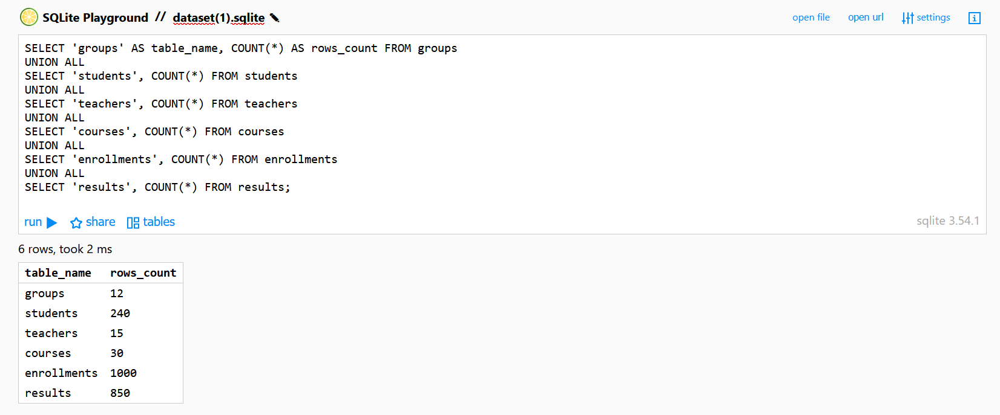


## Шаг 2. Изучение структуры базы данных и определение аналитических вопросов

На данном этапе была рассмотрена структура всех шести таблиц базы данных. Для каждой таблицы определены её назначение, основные поля и связи с другими таблицами.

### 2.1. Описание таблиц

**1. Таблица `groups` — учебные группы**

Содержит сведения об учебных группах, в которых обучаются студенты.

Основные данные:
- идентификатор группы;
- название группы;
- дополнительные сведения о группе.

Количество записей: **12**.

**2. Таблица `students` — студенты**

Хранит информацию о студентах, зарегистрированных в образовательной системе.

Основные данные:
- идентификатор студента;
- имя и фамилия;
- идентификатор учебной группы;
- дополнительные сведения о студенте.

Количество записей: **240**.

**3. Таблица `teachers` — преподаватели**

Содержит сведения о преподавателях, которые ведут учебные курсы.

Основные данные:
- идентификатор преподавателя;
- имя и фамилия;
- дополнительные сведения о преподавателе.

Количество записей: **15**.

**4. Таблица `courses` — учебные курсы**

Хранит информацию о курсах, доступных студентам.

Основные данные:
- идентификатор курса;
- название курса;
- идентификатор преподавателя;
- дополнительные сведения о курсе.

Количество записей: **30**.

**5. Таблица `enrollments` — зачисления на курсы**

Содержит информацию о записи студентов на учебные курсы.

Основные данные:
- идентификатор записи;
- идентификатор студента;
- идентификатор курса;
- дата зачисления;
- дополнительные сведения о записи.

Количество записей: **1000**.

**6. Таблица `results` — результаты обучения**

Хранит сведения об оценках и результатах прохождения курсов студентами.

Основные данные:
- идентификатор результата;
- идентификатор записи на курс;
- полученная оценка;
- дополнительные сведения о результате.

Количество записей: **850**.

### 2.2. Связи между таблицами

Таблицы базы данных связаны между собой с помощью первичных и внешних ключей.

Основные связи:
- `groups` и `students` — одна учебная группа может включать нескольких студентов;
- `students` и `enrollments` — один студент может иметь несколько записей о зачислении;
- `courses` и `enrollments` — на один курс могут записываться разные студенты;
- `teachers` и `courses` — один преподаватель может вести несколько курсов;
- `enrollments` и `results` — результаты обучения связаны с конкретными записями на курсы.

Таким образом, структура базы данных позволяет анализировать учебный процесс, участие студентов в курсах и полученные ими оценки.

### 2.3. Аналитические вопросы

На основе изученной структуры базы данных были сформулированы следующие вопросы:

1. Какие учебные курсы имеют самую высокую и самую низкую среднюю оценку? Учитывайте количество оценок при интерпретации.
2. Какие учебные группы включают наибольшее количество студентов?
3. Какие курсы пользуются наибольшим спросом у студентов?
4. Какие преподаватели ведут наибольшее количество учебных курсов?
5. Сколько студентов записано на каждый учебный курс?
6. Какие студенты получили наиболее высокие оценки?
7. На каких курсах отсутствуют результаты обучения?

### 2.4. Таблицы, необходимые для анализа

| Аналитический вопрос | Используемые таблицы |
|---|---|
| Средняя оценка по курсам | `courses`, `enrollments`, `results` |
| Количество студентов в группах | `groups`, `students` |
| Популярность курсов | `courses`, `enrollments` |
| Количество курсов у преподавателей | `teachers`, `courses` |
| Число записавшихся на курсы | `courses`, `enrollments` |
| Наиболее высокие оценки студентов | `students`, `enrollments`, `results` |
| Курсы без результатов | `courses`, `enrollments`, `results` |

### 2.5. Просмотр структуры таблиц

Для изучения структуры таблиц использовались SQL-запросы. Например, для просмотра информации о столбцах таблицы `enrollments` был выполнен запрос:

```sql
PRAGMA table_info(enrollments);
```

Для просмотра нескольких записей таблицы `students` использовался запрос:

```sql
SELECT * FROM students
LIMIT 5;
```

### Вывод

В ходе второго этапа была изучена структура базы данных, рассмотрено назначение шести таблиц и определены связи между ними. Также сформулированы семь аналитических вопросов, которые можно исследовать с помощью SQL-запросов.

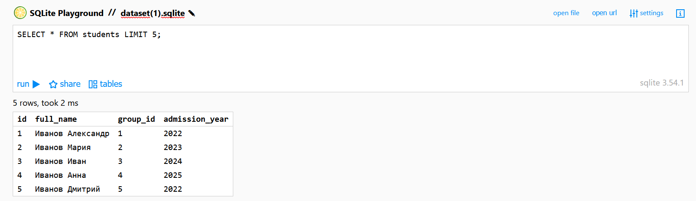
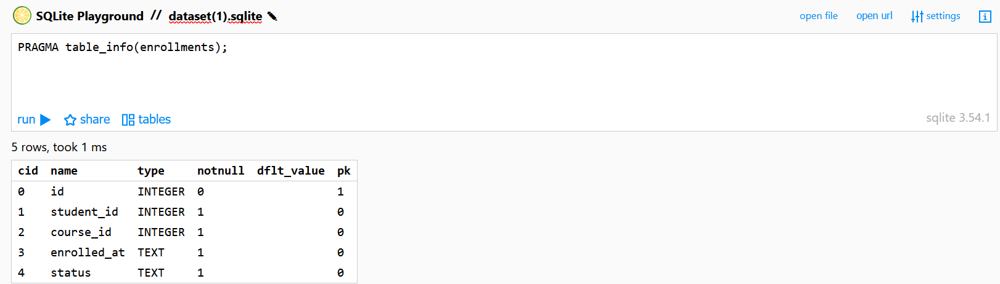


## Шаг 3. Фильтрация и сортировка данных

### 3.1. Фильтрация курсов по количеству часов

Для отбора учебных курсов продолжительностью не менее 60 часов использовался следующий SQL-запрос:

```sql
SELECT id, course_name, hours
FROM courses
WHERE hours >= 60
ORDER BY hours DESC, course_name
LIMIT 10;
```

**Результат:**

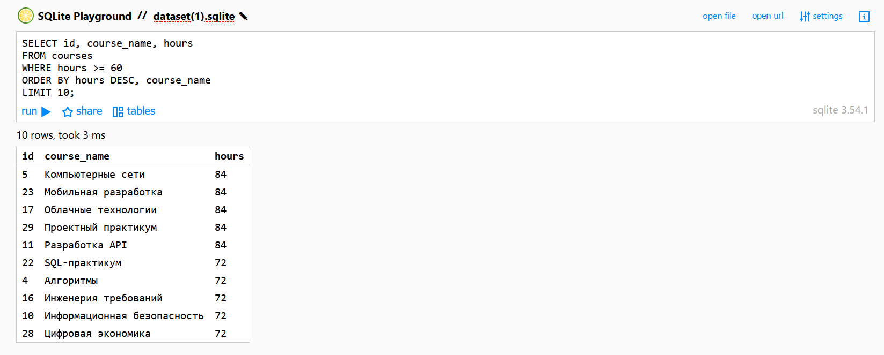

### 3.2. Сортировка студентов по алфавиту

Для получения списка студентов, поступивших в 2025 году, с сортировкой по имени был выполнен запрос:

```sql
SELECT id, full_name, admission_year
FROM students
WHERE admission_year = 2025
ORDER BY full_name
LIMIT 10;
```

**Результат:**


### Вывод

В ходе работы были использованы операторы фильтрации и сортировки SQL. Условие `WHERE` позволяет выбирать записи по заданным критериям, `ORDER BY` упорядочивает полученные данные, а `LIMIT` ограничивает количество отображаемых строк.


## Шаг 4. Агрегирование и группировка данных

### 4.1. Подсчёт записей

Для определения общего количества записей о зачислении студентов на курсы была использована функция `COUNT()`.

```sql
SELECT COUNT(*) AS total_enrollments
FROM enrollments;
```

**Результат:**

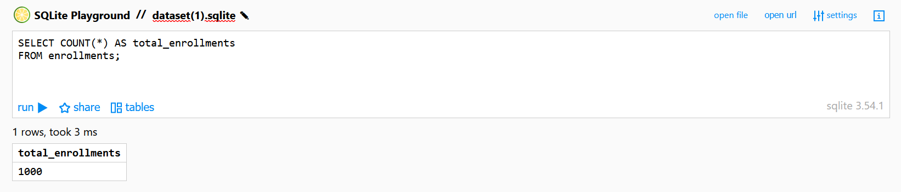

### 4.2. Применение агрегатных функций

Для анализа продолжительности учебных курсов были применены агрегатные функции `MIN()`, `MAX()`, `AVG()` и `SUM()`.

```sql
SELECT
    MIN(hours) AS min_hours,
    MAX(hours) AS max_hours,
    ROUND(AVG(hours), 2) AS avg_hours,
    SUM(hours) AS total_hours
FROM courses;
```

**Результат:**

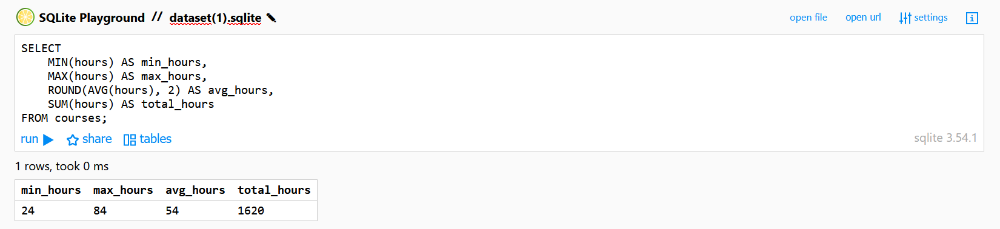

### 4.3. Группировка данных с помощью GROUP BY и HAVING

Для распределения записей по статусам использовалась группировка. С помощью `HAVING` были отобраны только те статусы, количество записей которых превышает 100.

```sql
SELECT
    status,
    COUNT(*) AS enrollments_count
FROM enrollments
GROUP BY status
HAVING COUNT(*) > 100
ORDER BY enrollments_count DESC;
```

**Результат:**

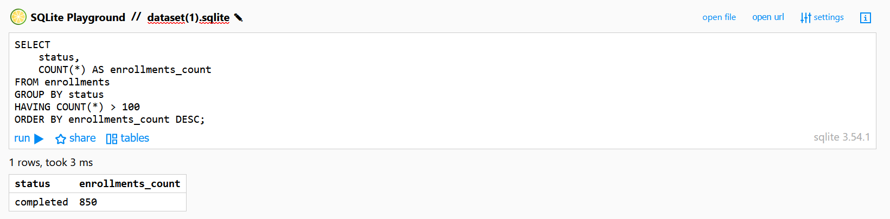

### Вывод

В ходе четвёртого этапа были изучены агрегатные функции SQL и способы группировки данных. Функция `COUNT()` позволяет подсчитывать количество записей, `MIN()` и `MAX()` находят минимальные и максимальные значения, `AVG()` вычисляет среднее значение, а `SUM()` определяет сумму. Оператор `GROUP BY` объединяет записи в группы, а `HAVING` задаёт условия отбора уже сформированных групп.


## Шаг 5. Объединение связанных таблиц

### 5.1. Объединение студентов и учебных групп

Для получения информации о студентах и соответствующих им учебных группах был использован оператор `INNER JOIN`. Он позволяет объединить данные из двух таблиц по общему идентификатору группы.

```sql
SELECT
    s.full_name AS student_name,
    g.group_name
FROM students s
INNER JOIN groups g ON g.id = s.group_id
ORDER BY s.id
LIMIT 10;
```

**Результат:**

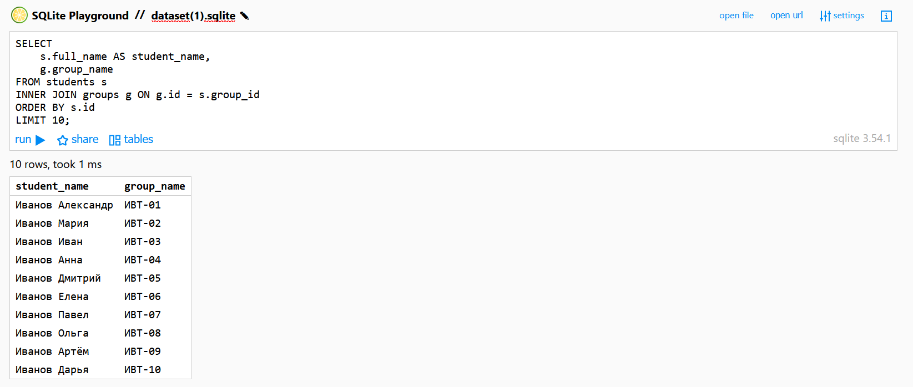

### 5.2. Объединение курсов и преподавателей

Для отображения учебных курсов вместе с именами преподавателей применён оператор `INNER JOIN`.

```sql
SELECT
    c.course_name,
    t.full_name AS teacher_name
FROM courses c
INNER JOIN teachers t ON t.id = c.teacher_id
ORDER BY c.id
LIMIT 10;
```

**Результат:**

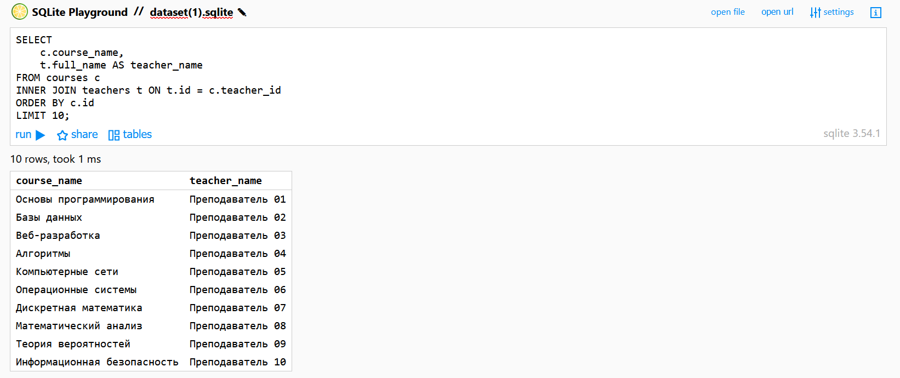

### 5.3. Объединение всех преподавателей с курсами

Для отображения полного списка преподавателей, включая тех, у кого нет назначенных курсов, использован оператор `LEFT JOIN`.

```sql
SELECT
    t.full_name AS teacher_name,
    c.course_name
FROM teachers t
LEFT JOIN courses c ON t.id = c.teacher_id
ORDER BY t.id, c.id;
```

**Результат:**

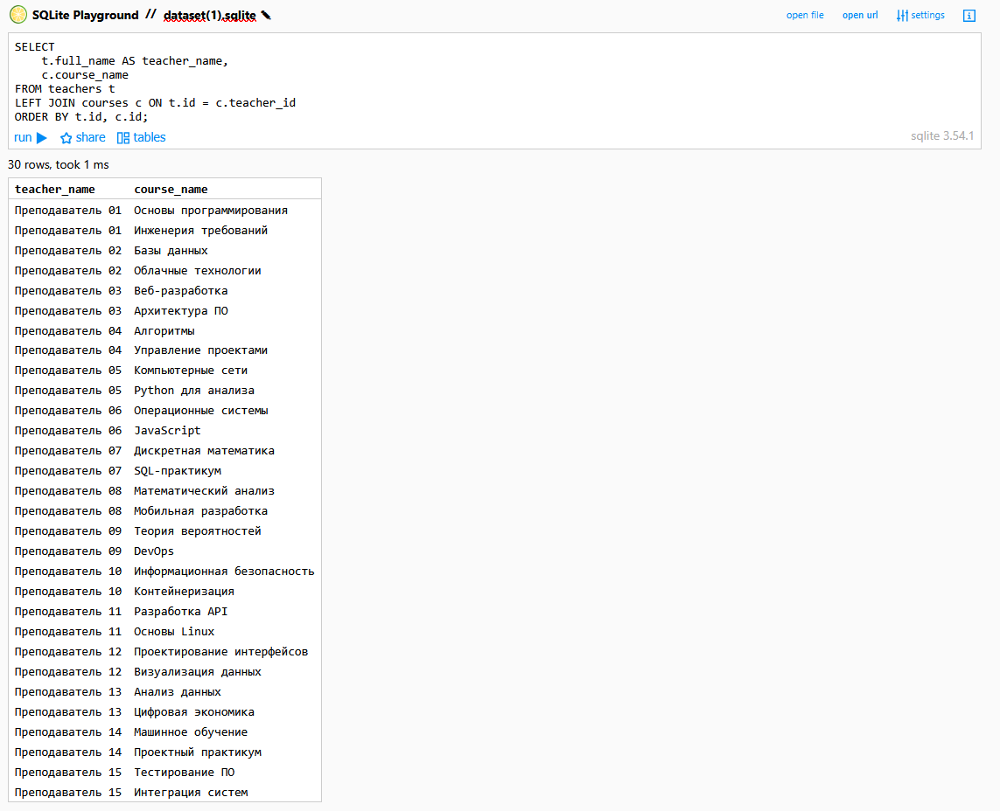

### Вывод

В ходе пятого этапа были рассмотрены способы объединения данных из нескольких таблиц. Оператор `INNER JOIN` возвращает записи, для которых найдены соответствия в обеих таблицах. Оператор `LEFT JOIN` сохраняет все записи из левой таблицы, даже если для некоторых из них отсутствуют связанные данные.


## Шаг 6. Проверка корректности данных

### 6.1. Проверка корректности оценок

Для выявления некорректных значений в таблице `results` был выполнен запрос, проверяющий наличие оценок за пределами допустимого диапазона и пустых значений.

```sql
SELECT COUNT(*) AS invalid_scores
FROM results
WHERE score < 0
   OR score > 100
   OR score IS NULL;
```

**Результат:**

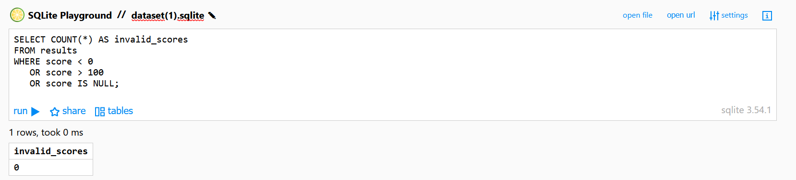

### 6.2. Проверка связей между результатами и записями на курсы

Для проверки правильности связей между таблицами `results` и `enrollments` был использован оператор `LEFT JOIN`. Запрос позволяет обнаружить результаты, для которых отсутствует соответствующая запись о зачислении.

```sql
SELECT COUNT(*) AS orphan_results
FROM results r
LEFT JOIN enrollments e ON r.enrollment_id = e.id
WHERE e.id IS NULL;
```

**Результат:**

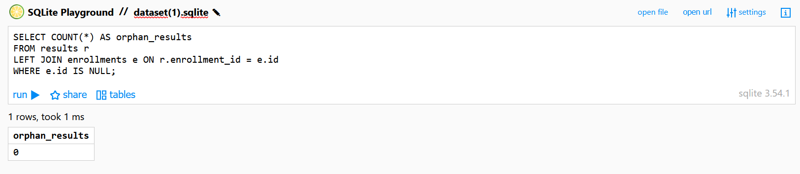

### Вывод

В ходе шестого этапа была проведена проверка качества данных. Первый запрос позволяет обнаружить оценки с некорректными или отсутствующими значениями. Второй запрос используется для поиска результатов, не связанных с существующими записями о зачислении. Полученные результаты позволяют оценить корректность значений и связей между таблицами.


## Шаг 7. Индивидуальное аналитическое исследование

**Вариант:** 1

**Исследовательский вопрос:** Какие учебные курсы имеют самую высокую и самую низкую среднюю оценку?

**Используемые таблицы:** `courses`, `enrollments`, `results`.

### Метод исследования

Для проведения анализа были объединены сведения об учебных курсах, записях студентов на курсы и результатах обучения. С помощью агрегатных функций `COUNT()` и `AVG()` рассчитывались количество оценок и средний балл по каждой дисциплине.

### 7.1. Анализ средних оценок по курсам

Для определения средней успеваемости студентов по каждому курсу был выполнен SQL-запрос:

```sql
SELECT
    c.course_name,
    COUNT(r.score) AS total_grades,
    ROUND(AVG(r.score), 2) AS avg_score
FROM courses c
INNER JOIN enrollments e ON c.id = e.course_id
INNER JOIN results r ON e.id = r.enrollment_id
GROUP BY c.id, c.course_name
ORDER BY avg_score DESC;
```

**Результат:**

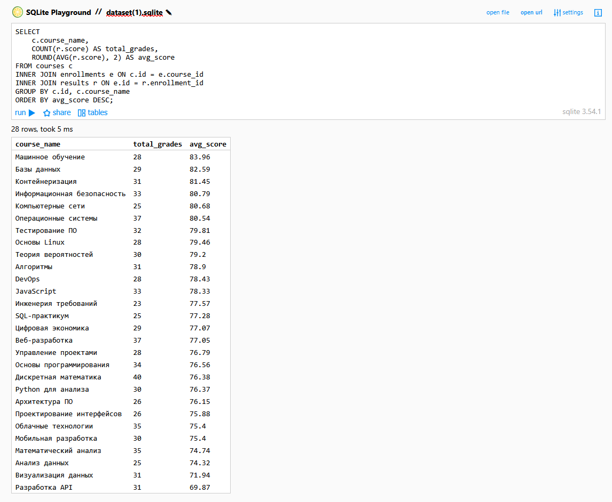

### 7.2. Поиск курсов без выставленных оценок

Для дополнительного анализа необходимо определить курсы, по которым отсутствуют результаты обучения. Для этого был использован запрос с `NOT EXISTS`.

```sql
SELECT
    c.id,
    c.course_name,
    c.hours
FROM courses c
WHERE NOT EXISTS (
    SELECT 1
    FROM enrollments e
    INNER JOIN results r ON e.id = r.enrollment_id
    WHERE e.course_id = c.id
);
```

**Результат:**

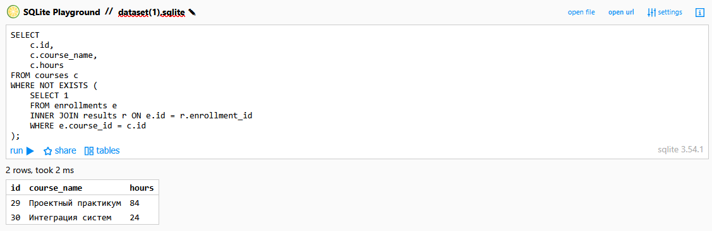

### 7.3. Аналитические выводы

По результатам исследования можно сделать следующие выводы:

1. Наиболее высокую среднюю оценку получил курс «Машинное обучение» — 83,96 балла. По нему выставлено 28 оценок.
2. Самый низкий средний балл среди рассмотренных курсов показала дисциплина «Разработка API» — 69,97 балла. Количество оценок по этому курсу составляет 31.
3. Обнаружены два курса без выставленных оценок: «Проектный практикум» и «Интеграция систем».
4. При сравнении курсов важно учитывать не только средний балл, но и количество оценок, на основе которых он рассчитан.

### 7.4. Ограничения исследования

Средняя оценка не отражает всех особенностей учебного процесса. При анализе не учитываются сложность дисциплин, особенности учебных групп и различия в критериях оценивания преподавателей. Кроме того, курсы без оценок невозможно включить в сравнение средней успеваемости.

### Общий вывод по лабораторной работе

В ходе лабораторной работы была изучена структура базы данных SQLite, состоящей из шести связанных таблиц. Были выполнены запросы для фильтрации, сортировки, агрегирования и группировки информации, объединения таблиц и проверки корректности данных. В заключительной части проведено индивидуальное исследование средней успеваемости по учебным курсам. Полученные результаты позволили определить курсы с наиболее высокими и низкими средними оценками, а также выявить дисциплины без выставленных оценок.
compare
